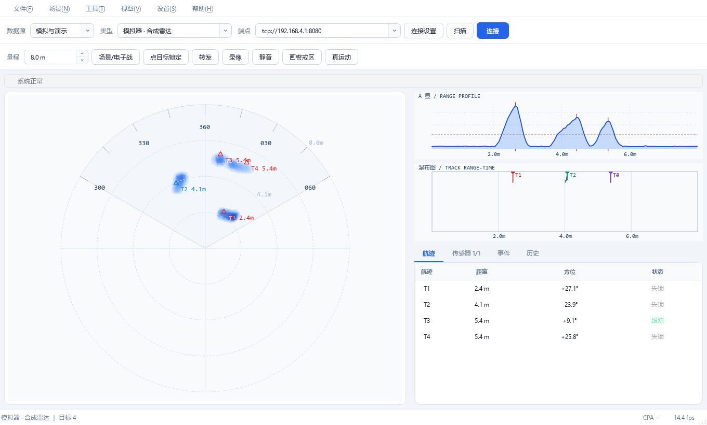
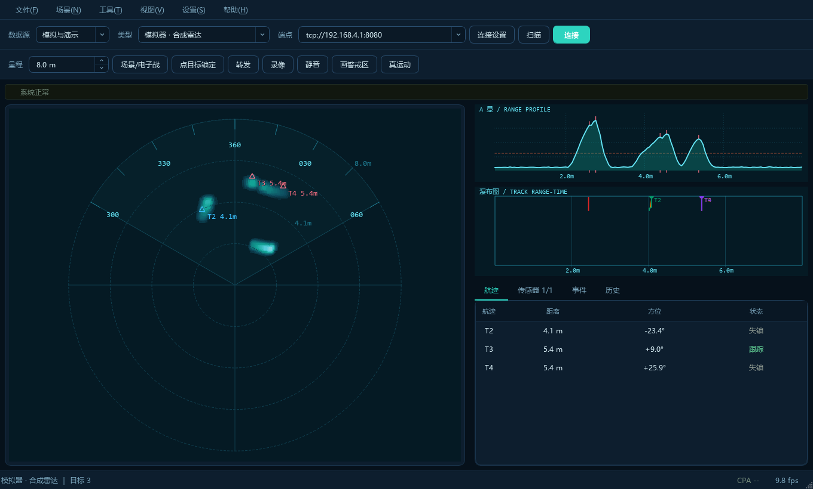
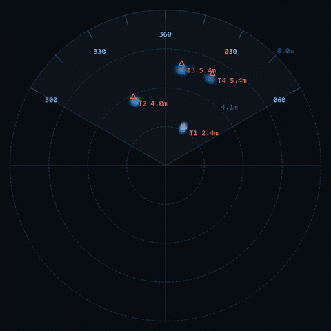

<div align="center">


# 瞭望 · Lookout

**通用雷达显控台 —— 插上就能用的雷达上位机**

支持毫米波 / 激光雷达 / 超声波 / 多站融合 / AIS / 联网地图，
一个界面覆盖从"刚焊好板子想看看有没有回波"到"多传感器组网监控"的全过程。







</div>

---

## 这是什么

市面上大部分雷达上位机是**跟着型号走的**：换一块板子就要换一个软件，
协议一变软件就废。瞭望换了个思路 —— 把"设备"和"界面"解耦：

- **协议在驱动里**，界面只认一个统一的数据模型（方位 + 距离 + 强度矩阵）
- **能力由设备声明**，界面按声明裁剪自己（没有多普勒就不显示 RD 图）
- **形态而非型号**决定显示方式：单点测距、扇区扫描、全向、目标跟踪、距离-多普勒、多站融合

所以加一款新雷达通常只需要写一个驱动文件，不用动界面。

> **定位**：以「插上就有画面」为入口（教学 / DIY / 课设），
> 以「可靠与可追溯」为深度（多站组网、告警、留证）。取舍规则见
> [ADR-0002](docs/ADR/0002-product-positioning.md)。

## 主要特性

| 分类 | 能力 |
|---|---|
| **显示** | PPI 环视、A 显距离剖面、航迹距离-时间瀑布图、距离-多普勒图、**3D 俯仰 RHI 距离-高度剖面**、余晖拖尾、尾迹、多普勒趋近着色、双量程近距窗、**7 套现代 UI 主题 × 8 套雷达色板** |
| **测量** | 点击测距、EBL 电子方位线 + VRM 距离圈、北向/艏向切换、真运动/相对运动 |
| **告警** | 距离/速度/圆形与多边形防区/目标数/接近率规则、画布绘制与右键编辑移动、分级提示、静音、CPA 最近会遇 |
| **检测** | 自适应 GO-CFAR、抗干扰 OS-CFAR、CA-CFAR、静态杂波背景图学习抑制（Clutter Map）、**陆地静止杂波掩膜 (Land Mask)** |
| **多站** | 6×60° 全向拼接、扇区共视、航迹级加权最小二乘交会、**多站交叉抗欺骗（疑似欺骗标黄）**、盲区标定、朝向标定向导 |
| **接入** | 串口（自动识别 CH340/CP210x + **Hex/ASCII 实时窥视与帧头嗅探**）、TCP/UDP、蓝牙 BLE、文件回放、**零代码通用协议适配向导**（7 套 NMEA TTM / `$SCAN` / TF / 77G / Modbus 预设） |
| **扩展** | AIS（NMEA 解析）、**NMEA 本船定位 (`$GGA/$RMC/$HDT`)**、在线图源与 **离线 `.mbtiles` 海图**、UDP 数据转发、WebSocket / **ROS 2 & Foxglove `.mcap` 互通**、插件系统（SHA256 信任确认） |
| **仿真** | 内置合成雷达 + 相控阵模拟 + **模拟电子站 & 电子战教学**（压制/DRFM/RGPO/VGPO/箔条云/ISRJ 干扰、烧穿距离圈、ESM 方位弧与模拟火控引导） |
| **工程** | SQLite 会话/航迹/事件、时间轴轨迹回放、统计分析、HTML/CSV 报表导出、中英双语切换、录像、无窗口自检 |

## 快速开始

### 直接用（推荐，无需安装 Python）

- **方式一（克隆 / 下载仓库 ZIP 即用）**：克隆本仓库或点击 GitHub 页面右上角 `Code → Download ZIP` 解压后，直接双击运行仓库内的 **`dist/Lookout/Lookout.exe`**。
- **方式二（Release 独立压缩包）**：前往 [GitHub Releases](https://github.com/sun2006-xin/lookout-radar/releases/latest) 下载 `Lookout-v1.3.0-win64.zip`，解压后双击 `Lookout.exe` 即可运行。

首次打开默认进入 **数据源 → 模拟与演示 → 模拟器 · 合成雷达**，点击「连接」即可看到动态扫描与航迹；可在顶栏 **`场景`** 一键切换航海轮船避碰、车载 77G、低空无人机或教学电子战干扰模式。

### 从源码跑

```bat
.venv\Scripts\python.exe -m pip install -r requirements.txt
.venv\Scripts\python.exe main.py
```

### 打包成 exe

```bat
.venv\Scripts\pyinstaller.exe --noconfirm --clean installer\Lookout.spec
```

打完后跑一次 `dist\Lookout\Lookout.exe --selftest`（**不开窗口**）验证产物。

## 接自己的设备

点工具栏「连接设置」，四个页签：

- **串口 / USB** —— 枚举本机串口，按 USB VID 识别 CH340 / CP210x / FTDI / Pico / STM32 虚拟串口并优先选中；可选波特率，带「测试连接」直接告诉你收到多少字节
- **网络** —— TCP 客户端 / UDP 监听（雷达主动推）
- **蓝牙 BLE** —— 扫描附近设备（需 `pip install bleak`）；经典蓝牙模块配对后是串口，走第一页
- **文件回放** —— 重放 `.rad` 录制

端点就是一个字符串，也可以手输：

```
serial://COM5?baud=256000
tcp://192.168.4.1:8080
udp://0.0.0.0:9000
ble://AA:BB:CC:DD:EE:FF
```

加 `&record=capture.bin` 可把原始字节流存下来做协议分析。

## 已适配与支持范围

| 设备 / 协议 | 形态 | 说明 |
|---|---|---|
| 内置模拟器 & 模拟电子站 | 扇区 / 全向 / 多站 | 无需硬件即可演示（支持航海 / 车载 / 无人机场景与电子战干扰注入） |
| 相控阵/脉冲多普勒仿真 | RD | 9 目标 + 距离多普勒图 + IFF + 威胁分级 |
| LD2450 / LD2410 | 毫米波 | 24G 人体存在与三目标跟踪，串口直连 |
| LD19 / LD06 / D500 | 激光雷达 | 360° 旋转扫描，CRC 校验 + 碎片重同步 |
| HC-SR04 + 舵机 | 超声波 | 180° 机械扫描，文本协议（`firmware/` 附示例固件） |
| 航海雷达（`nmea_ttm`） | 全向 | 标准 NMEA-0183 `$RATTM` ARPA 目标报文（海里/节自动换算） |
| 77G / 通用串口二进制（`traffic_csv` / `uart_bin_cm`） | 扇区 | 零代码「通用协议雷达适配向导」预设与在线样本试解析 |
| 多站融合（`multi` / `multi_demo`） | 6×60° | 多台传感器标定拼接与航迹级最小二乘交会 |

> 真机联调前可在「连接设置」先跑「测试连接」检查字节流；未列出的私有串口/网口雷达可直接在「工具 → 通用协议雷达适配向导」零代码配置，也可放插件进 `plugins/`。

## 数据转发（把软件当雷达服务器用）

工具栏点「转发」，填 `127.0.0.1:9100`（本机）或 `255.255.255.255:9100`（广播）。
每帧一个 UDP 包，JSON：

```json
{"type":"radarscope.frame","v":1,"ts":1700000000.123,"seq":42,"range_max":8.0,
 "targets":[{"tid":1,"x":1.2,"y":3.4,"vx":0.1,"vy":0.2,"snr":0.8,
             "cls":"","views":2,"threat":0}]}
```

接收端十行就能跑：

```python
import socket, json
s = socket.socket(socket.AF_INET, socket.SOCK_DGRAM)
s.bind(("0.0.0.0", 9100))
while True:
    data, _ = s.recvfrom(65535)
    for t in json.loads(data)["targets"]:
        print(t["tid"], t["x"], t["y"])
```

## 快捷键

| 键 | 作用 |
|---|---|
| 空格 | 暂停 / 继续画面 |
| `L` / `Esc` | 开关点选锁定 / 解除锁定 |
| `+` `-` | 增减量程 |
| `Ctrl` `+` `-` `0` | 界面字号缩放 / 复位 |
| 左键点空白 | 显示该处距离与方位 |
| 右键 | 放置 EBL/VRM；右键警戒区可编辑参数、拖动调整或单个删除 |

## 插件

`plugins/` 下丢一个 `.py` 就能加告警规则或驱动，重启生效。

```python
def setup(api):
    api.add_rule(ZoneRule("no_go", cx=0, cy=3, r=1.5))
    api.add_driver(MyRadarDriver)
```

现有示例：`parking_rules.py`（泊车规则）、`example_sweep_ranger.py`（自定义驱动）。

## 架构与文档

| 文档 | 内容 |
|---|---|
| [docs/ARCHITECTURE.md](docs/ARCHITECTURE.md) | 系统分层、数据流、五条数据契约与驱动扩展指南 |
| [docs/STRUCTURE.md](docs/STRUCTURE.md) | 源码目录与逐文件职责索引 |
| **[docs/ROADMAP.md](docs/ROADMAP.md)** | **开发计划与路线图**：软件生态 / 模拟电子战与硬件阶段 A~F |
| [docs/ADR](docs/ADR) | 核心架构决策记录（技术选型与产品定位） |

## 测试

```bat
.venv\Scripts\python.exe tests\test_core.py   :: 49 组
.venv\Scripts\python.exe tools\check.py       :: 编译 + 测试 + 链路自检 + 夹具回归
```

不打桩：测试直接跑真实算法与真实 SQLite。CI 见 `.github/workflows/ci.yml`，
覆盖 `Windows / Linux / macOS` × Python `3.11 / 3.12`（无头 `QT_QPA_PLATFORM=offscreen`）。

演示动图由 `tools/make_demo.py` 离屏生成（`tools/requirements-dev.txt` 里的 Pillow）。

## 已知限制

- **真机实测尚未完全覆盖**：LD19/LD06、LD2450/LD2410、BLE 实机及真实多站组网有录制夹具回归，但仍需对应实体硬件进一步联调（见 [ROADMAP.md](docs/ROADMAP.md) 阶段 A）
- **GIS 底图**仅支持开源栅格瓦片（OSM/CARTO）与离线磁盘缓存，无矢量要素编辑；室外 `≥30 m` 量程可见街道/岸线，IP 自动定位仅城市级精度
- **STC/FTC** 走 `set_control()` 下行通道，目前仅模拟器完整响应（真机驱动需按设备协议覆写）
- 只解 AIS 位置报告（1/2/3/18/19），不处理静态与航程报文
- **真运动**边缘在极大量程下的边界显示仍可继续打磨

## 路线图

- [x] 目标历史轨迹回放（时间轴拖动与倍速播放）
- [x] 告警区支持多边形与画布右键编辑/移动/单个删除
- [x] 中英文界面实时切换（i18n）与 HTML/CSV 报表导出
- [x] 模拟电子站、教学级电子对抗全流程与多站抗欺骗（E1~E5、E9、F1~F3）
- [x] 离线 MBTiles 海图 + NMEA 本船定位 + 陆地掩膜 + ROS/Foxglove `.mcap` + 3D RHI 剖面（E6~E8）
- [ ] **阶段 A 实机联调**：LD19/LD06、LD2450/LD2410、BLE 真机与真实多站组网
- [ ] **阶段 B4 原始 ADC → FFT 链路**：需要 IWR6843 + DCA1000 等相参硬件
- [ ] 真机雷达参数下行下发与协议适配扩展

## 许可与致谢

MIT License，见 [LICENSE](LICENSE)；第三方资源归属见 [NOTICE.md](NOTICE.md)。

地图瓦片 © OpenStreetMap contributors（ODbL），由 CARTO 渲染。
使用联网地图时界面会显示归属信息，这是使用条件的一部分。

---

<div align="center">

如果这个项目帮你省下了读协议手册的时间，欢迎 Star ⭐

</div>
