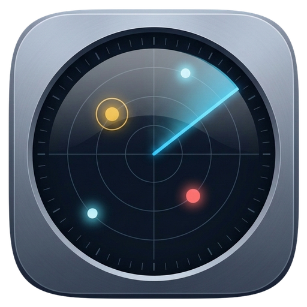
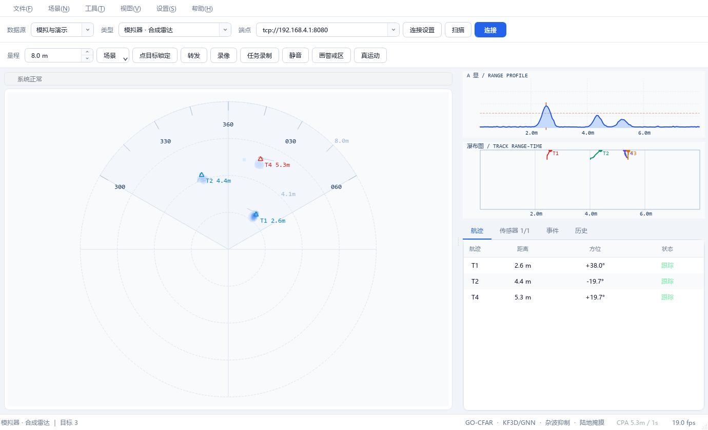
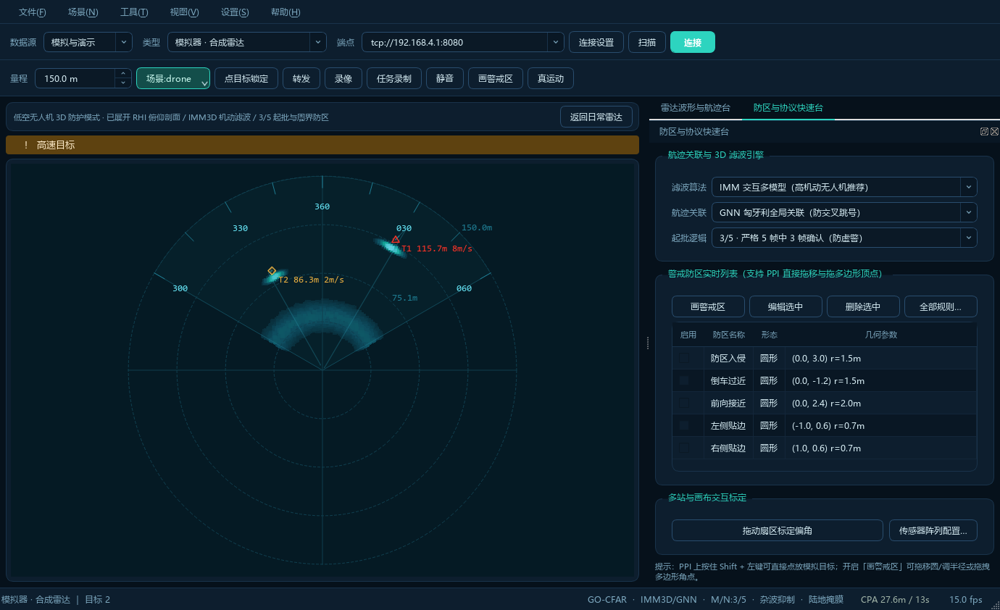
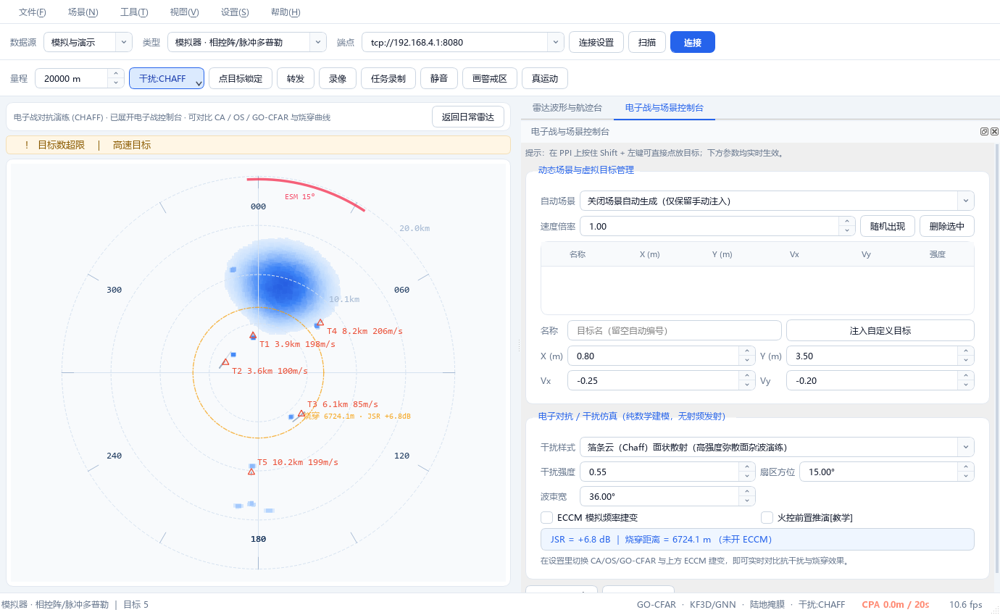
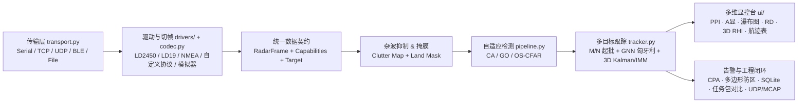

<div align="center">



# 瞭望 · Lookout

**通用雷达显控台 · 多传感器融合 · 算法评测与教学仿真上位机**

[](https://github.com/sun2006-xin/lookout-radar/releases/latest)
[](LICENSE)
[](https://github.com/sun2006-xin/lookout-radar/actions/workflows/ci.yml)

支持 **24G/77G 毫米波雷达 · 2D/3D 激光雷达 · 超声波 · NMEA 航海雷达 · BLE 设备 · 零代码自定义协议**。<br>
一个上位机覆盖从 **「焊好板子插上看看回波」** 到 **「CA/GO/OS-CFAR 检测 · GNN 3D 航迹跟踪 · 多站融合 · 电子战教学 · 任务包复盘」** 的完整闭环。

| 日常纯净显控（浅色专业主题） | 低空无人机 3D RHI / IMM 防护（深色战术） | 电子战抗干扰与烧穿演练（停靠控制台） |
| :---: | :---: | :---: |
|  |  |  |

<br>


</div>

---

## 为什么选择「瞭望 Lookout」

市面上大多数雷达上位机是**跟硬件型号强绑定**的：换一款模块就要重装另一套上位机，协议字节改一位软件就无法解析。**瞭望**采用「设备驱动 ↔ 信号流水线 ↔ 显控界面」三层解耦架构：

1. **协议封装在驱动与编解码层**：串口、TCP、UDP、BLE 与 `.rad` 文件回放统一收敛在 `transport.py` + `codec.py`，所有硬件与仿真驱动只需输出统一数据契约（`Capabilities` + `RadarFrame` + `Target`）。
2. **界面按设备能力自动裁剪**：界面不认识具体型号，只看设备能力声明——没有多普勒不显示 RD 图，没有俯仰角不占 RHI 高度空间，支持单点、扇区、全向、脉冲多普勒与多站融合形态自由切换。
3. **日常显控与专项工作台按需展开**：日常使用保持纯净经典的雷达显控布局；切换到航海避碰、低空无人机或电子战演练时，自动展开对应停靠面板与推荐检测滤波参数，点击顶栏 **「返回日常雷达」** 即可一键还原。

> 设计边界与产品取舍详见 [docs/ADR/0002-product-positioning.md](docs/ADR/0002-product-positioning.md)。

---

## 适用人群与典型用途

| 使用场景 | Lookout 能为你解决什么 |
|---|---|
| **硬件创客 / 嵌入式联调** | 接入 LD2450 / LD2410 / LD19 / 超声波舵机或自制 MCU 板卡，自带 Hex/ASCII 报文窥视、`&record=` 原始字节录制与断流自动重连，快速验证硬件是否出数、坐标方向是否正确。 |
| **私有协议快速接入** | 无需改动 Python 源码，通过 **零代码通用协议适配向导** 可直接加载 `$RATTM` / 77G CSV / 串口定长二进制报文，支持样本实时试解析。 |
| **雷达信号与跟踪算法实验** | 内置合成雷达与相控阵/脉冲多普勒仿真器，实时对比 **CA / GO / OS-CFAR**、静态杂波背景图（Clutter Map）、**M/N 起批确认**、**GNN 匈牙利匹配** 与 **3D Kalman / IMM 机动滤波**。 |
| **高校课程与电子战教学** | 无需射频发射硬件，纯数学建模演示噪波压制、DRFM 假目标、RGPO/VGPO 距离速度拖引、箔条云与 ISRJ 干扰，直观观察 **JSR 干信比、理论烧穿距离圈、ESM 方位弧** 与 **ECCM 频率捷变** 抗干扰效果。 |
| **工程交付与二次开发** | 支持多站 6×60° 拼接与交叉抗欺骗、在线/离线 `.mbtiles` 海图 + AIS + NMEA 本船定位、UDP JSON 广播、WebSocket 大屏与 **ROS 2 / Foxglove `.mcap`** 导出；并可用 Python 插件扩展驱动与告警规则。 |

---

## 核心处理流水线与架构



- **硬分层约束（CI / AST 强制校验）**：`radarscope/core/` 禁止导入任何 `PyQt5`，确保核心算法可 100% 脱离界面测试；`radarscope/ui/` 禁止直接出现 `struct.unpack` 或 `serial`，防止协议解析污染界面层。

---

## 场景预设与电子战演练

在顶栏 **「场景」** 按钮或菜单切换场景后，若当前尚未连接且处于模拟数据源，软件会自动拉起最匹配的模拟器与停靠控制台：

| 场景模式 | 自动协同配置 | 核心验证能力 |
|---|---|---|
| **日常经典雷达 (`none`)** | 隐藏专项停靠台与横幅，恢复经典显控布局 | 日常真机/演示监控、纯粹波形与航迹观察 |
| **航海避碰演练 (`marine`)** | 2000m 量程 · 旋转扫描 · GO-CFAR · 海图 + AIS + 陆地掩膜 + 防区台 | 航道交叉 / 追越 / 对遇会遇，CPA/TCPA 碰撞预警 |
| **车载 77G 交通 (`automotive`)** | 80m 量程 · 凝视前向视场 · OS-CFAR · Kalman 3D · 2σ 置信椭圆 | 多车道前车减速、邻道切入、高速相对速度跟踪 |
| **低空无人机 3D (`drone`)** | 150m 量程 · `rhi_3d` 俯仰剖面 · IMM 3D 机动滤波 · `3/5` 严格起批 | 悬停/机动突防目标跟踪、距离-高度剖面监控、周界入侵 |
| **多目标交叉 (`crossing`)** | GNN 匈牙利全局匹配 · Kalman 3D · 2σ 置信椭圆 | 密集目标交叉瞬间防 `tid` 跳号与航迹稳定性评估 |
| **高速逼近告警 (`approach`)** | OS-CFAR · IMM 3D · 防区快速台 | 高速目标突防时的起批响应与告警去抖验证 |
| **电子战对抗演练 (`EW`)** | 展开右侧「电子战与场景控制台」· 切换 6 种干扰样式与 ECCM | 噪波压制 / DRFM / RGPO / VGPO / 箔条云 / ISRJ + 火控前置角 |

> 连接**真实实体雷达**时，切换演练场景可叠加虚拟测试目标（含画布直接点击注入），但软件会自动保护真机物理量程 `range_spin`，避免预设强切破坏实测比例尺。

---

## 主要功能一览

- **多视图与视觉系统**
  - PPI 环视（余晖拖尾、历史尾迹、多普勒趋近着色、真运动/相对运动、北向/艏向切换、2σ 轨迹误差置信椭圆）
  - A 显距离剖面、航迹距离-时间瀑布图、脉冲多普勒距离-多普勒（RD）图、**3D 俯仰 RHI 距离-高度剖面图**
  - **7 套现代 UI 主题**（浅色 / 北欧灰 / 深色 / 石墨 / 海军夜视 / 战术暗夜 / 琥珀作战）× **8 套雷达色板**，支持 `Ctrl + / - / 0` 全局字体缩放
- **画布直接交互操作**
  - **Shift + 左键**：直接在 PPI 画布点选位置注入可运动仿真目标
  - **开启「画警戒区」**：直接在画布绘制圆形/多边形防区，支持拖拽圆心/半径、拖拽多边形顶点微调、右键单个编辑或删除
  - **多站布阵交互**：支持鼠标在画布直接拖动旋转扇区朝向标定偏角，配合 6×60° 拼接与交叉抗欺骗（疑似欺骗目标标黄）
  - **双向锁定**：PPI 点击目标或航迹表选中行实现双向锁定与 CPA/TCPA 实时追踪
- **海图、定位与外部生态**
  - 在线栅格图源（OSM / CARTO，200MB 磁盘缓存配额 + IP 城市定位）与 **离线 `.mbtiles` 瓦片包**
  - NMEA-0183 AIS 船位解析 + `$GPGGA / $GNRMC / $HEHDT / $RARSD` 本船定位航向接入
  - **一键任务包录制与离线对比**：同步封存 `manifest.json`、`frames.rad` 与参数快照，支持回放时对同一段真实回波切换不同 CFAR/杂波/滤波参数重算对比
  - **数据输出**：SQLite 会话/航迹/事件归档、时间轴倍速回放、统计报表（HTML/CSV）、屏幕 PNG 录像、UDP JSON 转发、WebSocket 浏览器看图与 **ROS 2 / Foxglove `.mcap`** 导出

---

## 快速开始

### 方式一：直接运行免安装版（Windows 推荐，无需安装 Python）

- **GitHub Release（推荐）**：前往 [Releases 最新版](https://github.com/sun2006-xin/lookout-radar/releases/latest) 下载 `Lookout-v1.3.1-win64.zip`，解压后双击 **`Lookout.exe`** 即可启动。
- **仓库自带绿色版**：克隆仓库或下载源码 ZIP 后，直接运行仓库内的 **`dist/Lookout/Lookout.exe`**。

首次打开默认选中 **数据源 → 模拟与演示 → 模拟器 · 合成雷达**，点击右上角蓝色 **「连接」** 按钮即可看到实时扫描与航迹；也可以直接点击工具栏 **「场景」** 体验五大行业/对抗场景。

### 方式二：从源码运行与自检

```bat
:: 1. 安装依赖（建议使用虚拟环境）
.venv\Scripts\python.exe -m pip install -r requirements.txt

:: 2. 启动图形界面
.venv\Scripts\python.exe main.py

:: 3. 无窗口自检 / 全量本地验证（编译 + 50 组单元测试 + 自检 + 夹具回归）
.venv\Scripts\python.exe main.py --selftest
.venv\Scripts\python.exe tools\check.py
```

### 方式三：自行打包 Windows 可执行程序

```bat
.venv\Scripts\pyinstaller.exe --noconfirm --clean installer\Lookout.spec
dist\Lookout\Lookout.exe --selftest
```

---

## 硬件接入与协议适配

点击工具栏 **「连接设置」** 即可通过图形向导配置四种链路（支持 `测试连接` 实时窥视 Hex/ASCII 字节流并统计收包字节数）：

| 传输方式 | 端点格式示例 | 说明 |
|---|---|---|
| **串口 / USB** | `serial://COM5?baud=256000` | 自动识别 CH340 / CP210x / FTDI / Pico / STM32 虚拟串口，并按当前所选驱动自动匹配默认波特率 |
| **TCP 客户端** | `tcp://192.168.4.1:8080` | 连接 Wi-Fi / 以太网透传雷达或本地仿真服务端 |
| **UDP 监听** | `udp://0.0.0.0:9000` | 监听雷达主动推送的数据报文 |
| **蓝牙 BLE** | `ble://AA:BB:CC:DD:EE:FF` | 扫描并连接 BLE GATT 设备（需 `bleak`）；经典蓝牙配对后走串口 |
| **帧归档回放** | `file:///path/to/capture.rad` | 重放软件录制的 `.rad` 原始帧归档 |

> 在任意端点末尾追加 `&record=capture.bin`，即可边显示边落盘原始硬件字节流（每 4KB / 1 秒自动 `flush`），方便离线分析私有协议。

### 已内置驱动与协议范围

| 设备 / 协议 | 形态 | 说明 |
|---|---|---|
| 内置合成模拟器 & 模拟电子站 | 扇区 / 全向 / 3D RHI | 旋转/凝视/3D 俯仰三模，支持增益 / STC / FTC 下行控制演示 |
| 相控阵 / 脉冲多普勒仿真 (`sim_aesa`) | RD + PPI | 9 目标 + 距离多普勒热图 + IFF + 威胁分级 |
| 海凌科 **LD2450 / LD2410** | 毫米波 | 24G 存在感应（9 距离门）与三目标跟踪，支持连帧突发缓冲与径向速度矢量投影 |
| 乐动 **LD19 / LD06 / D500** | 激光雷达 | 360° 旋转扫描（默认 230400 bps），CRC 校验 + 碎片重同步 |
| **HC-SR04 + 舵机** | 超声波 | 180° 机械扫描文本协议（`firmware/hc_sr04_servo.ino` 附完整固件） |
| 航海 ARPA (`nmea_ttm`) | 全向 | 标准 NMEA-0183 `$RATTM` 报文（海里/节自动换算米制） |
| 77G / 自定义串口或网口设备 | 扇区 / 全向 | 通过 **「工具 → 通用协议雷达适配向导」** 零代码配置 CSV 文本或定长二进制帧 |
| 多站融合 (`multi` / `multi_demo`) | 6×60° 融合 | 多站标定拼接、最小二乘交会与交叉抗欺骗 |

### 真机联调稳定性机制（v1.3.1）

- **5 秒静默断流看门狗**：实测设备连上后若超过 5 秒无有效目标/扫频帧，自动触发指数退避重连，防止雷达模块掉电或假死后界面僵死。
- **驱动默认波特率自适应**：切换 `LD19 (230400)`、`Ultrasonic (115200)`、`LD2450 (256000)` 等驱动时，自动更新默认串口波特率参数。
- **BLE 读写连接复用与断连感知**：并发下发控制指令时复用同一条活跃 `BleakClient` 事件循环，不与通知订阅抢占连接。

---

## 数据转发、Web 与插件开发

### 1. UDP 实时数据转发

点击工具栏 **「转发」**，填写目标地址（如 `127.0.0.1:9100`），每帧推送一条 JSON 报文：

```json
{
  "type": "radarscope.frame",
  "v": 1,
  "ts": 1700000000.123,
  "seq": 42,
  "range_max": 8.0,
  "targets": [
    {"tid": 1, "x": 1.2, "y": 3.4, "vx": 0.1, "vy": 0.2, "snr": 0.8, "cls": "", "views": 2, "threat": 0}
  ]
}
```

配合仓库工具 [tools/ws_bridge.py](tools/ws_bridge.py) 与 [tools/web_viewer.html](tools/web_viewer.html)，还可将雷达目标流零依赖桥接到浏览器端实时显示。

### 2. Python 插件扩展

将 `.py` 文件放入 `plugins/` 目录并在界面内勾选信任即可扩展自定义告警规则或雷达驱动（内置示例见 [plugins/parking_rules.py](plugins/parking_rules.py) 与 [plugins/example_sweep_ranger.py](plugins/example_sweep_ranger.py)）：

```python
def setup(api):
    api.add_rule(ZoneRule("no_go", cx=0, cy=3, r=1.5))
    api.add_driver(MyRadarDriver)
```

---

## 快捷键与常用画布操作

| 操作 / 快捷键 | 功能 |
|---|---|
| `Space` | 暂停 / 继续实时画面 |
| `L` / `Esc` | 开启点选锁轨 / 解除当前锁定目标 |
| `+` / `-` | 增大 / 减小当前显示量程 |
| `Ctrl` + `+` / `-` / `0` | 全局界面字号缩放 / 复位 |
| `Shift` + 左键点击 PPI | 在指针位置直接投放一个可运动仿真目标 |
| 左键点击 PPI 空白处 | 显示该点极坐标距离与方位读数 |
| 右键点击 PPI / 警戒区 | 放置或清除 EBL/VRM 电子方位距标；右键警戒区可编辑、拖拽顶点或删除 |

---

## 架构文档、测试与路线图

### 项目文档

| 文档 | 内容说明 |
|---|---|
| [docs/ARCHITECTURE.md](docs/ARCHITECTURE.md) | 系统分层、线程模型、五条数据契约与新驱动扩展规范 |
| [docs/STRUCTURE.md](docs/STRUCTURE.md) | 源码目录树与逐文件核心职责索引 |
| [docs/ROADMAP.md](docs/ROADMAP.md) | 已完成能力清单与后续硬件/算法迭代规划（阶段 A~F） |
| [docs/ADR](docs/ADR) | 核心架构决策记录（技术选型依据与产品定位取舍） |

### 自动化测试与 CI

项目内置 **50 组不打桩（Zero-Mock）核心测试**，直接运行真实信号检测、跟踪、SQLite 持久化、离线任务对比与录制夹具回归：

```bat
.venv\Scripts\python.exe tests\test_core.py   :: 50 组单元测试
.venv\Scripts\python.exe tools\check.py       :: 编译 + 单元测试 + 链路自检 + 5 份夹具回归
```

GitHub Actions（[.github/workflows/ci.yml](.github/workflows/ci.yml)）在 **`Windows / Ubuntu / macOS` × Python `3.11 / 3.12`**（无头 `QT_QPA_PLATFORM=offscreen`）持续执行全量验证。

### 已知边界与后续计划

- [x] **软件生态与显控全线完善**：7 套 UI 主题、场景驱动自适应停靠台、画布直编辑与多边形顶点拖拽、3D RHI 剖面
- [x] **深水区跟踪与检测**：CA/GO/OS-CFAR、静态杂波背景图、陆地掩膜、M/N 起批、GNN 匈牙利匹配与 3D Kalman/IMM
- [x] **外部互通与任务闭环**：离线 `.mbtiles` 海图、AIS + NMEA 本船定位、ROS 2 `.mcap`、一体化任务包录制与离线重算对比
- [ ] **阶段 A 实机现场联调**：目前 LD19/LD06、LD2450/LD2410、BLE 与多站组网均通过录制夹具与传输层加固回归，仍待对应实体硬件进行现场实测标定
- [ ] **阶段 B4 原始 ADC → FFT 处理链**：待接入 IWR6843 + DCA1000 等相参原始中频采样硬件后展开
- **已知小边界**：联网 GIS 栅格瓦片在室外 `>= 30 m` 量程可见街道与岸线，IP 自动定位为城市级精度；`STC/FTC` 下行参数控制目前仅内置模拟器完整响应；AIS 聚焦位置报告（消息类型 1/2/3/18/19）。

---

## 许可与致谢

- 开源协议：[MIT License](LICENSE)，第三方资源与图源归属见 [NOTICE.md](NOTICE.md)。
- 地图瓦片 © OpenStreetMap contributors（ODbL），由 CARTO 渲染；启用联网海图时界面左下角自动保留合规归属信息。

<div align="center">

如果 **瞭望 Lookout** 帮你省下了重写上位机或啃协议手册的时间，欢迎点一个 ⭐ Star 支持！

</div>
