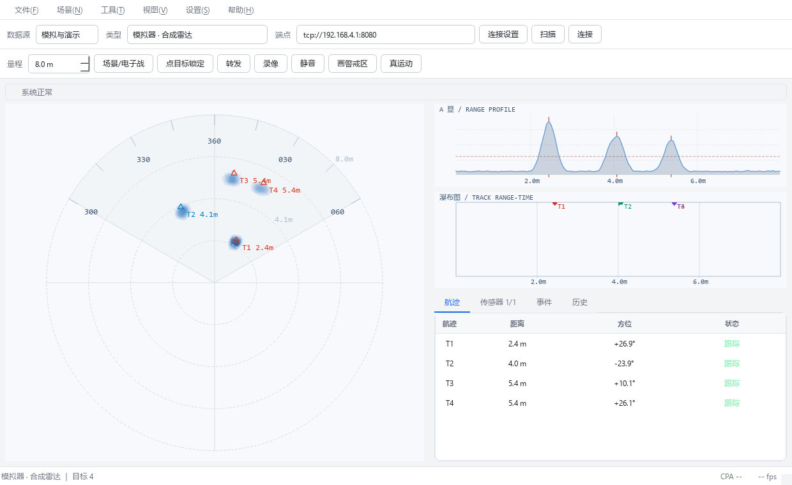
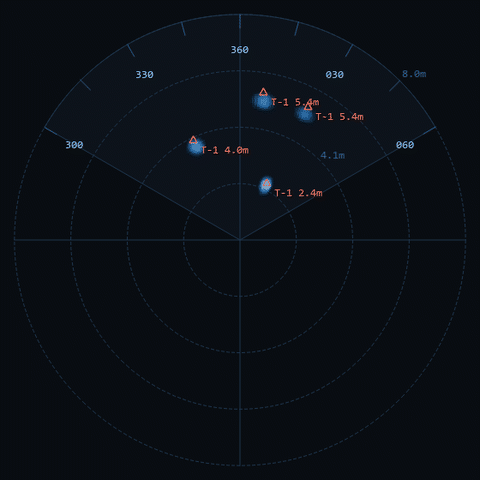

<div align="center">


# 瞭望 · Lookout

**通用雷达显控台 —— 插上就能用的雷达上位机**

支持毫米波 / 激光雷达 / 超声波 / 多站融合 / AIS / 联网地图，
一个界面覆盖从"刚焊好板子想看看有没有回波"到"多传感器组网监控"的全过程。





</div>

---

## 这是什么

市面上大部分雷达上位机是**跟着型号走的**：换一块板子就要换一个软件，
协议一变软件就废。瞭望换了个思路 —— 把"设备"和"界面"解耦：

- **协议在驱动里**，界面只认一个统一的数据模型（方位 + 距离 + 强度矩阵）
- **能力由设备声明**，界面按声明裁剪自己（没有多普勒就不显示 RD 图）
- **形态而非型号**决定显示方式：单点测距、扇区扫描、全向、目标跟踪、距离-多普勒、多站融合

所以加一款新雷达通常只需要写一个驱动文件，不用动界面。

> **定位**：以「插上就有画面」为入口（教学 / DIY / 课设），
> 以「可靠与可追溯」为深度（多站组网、告警、留证）。取舍规则见
> [ADR-0002](docs/ADR/0002-product-positioning.md)。

## 主要特性

| 分类 | 能力 |
|---|---|
| **显示** | PPI 环视、A 显距离剖面、距离-时间瀑布、距离-多普勒图、余晖拖尾、尾迹、双量程近距窗 |
| **测量** | 点击测距、EBL 电子方位线 + VRM 距离圈、北向/艏向切换、真运动/相对运动 |
| **告警** | 距离/速度/区域/目标数/接近率规则、画布上直接画警戒区、分级提示、静音、CPA 最近会遇 |
| **多站** | 6×60° 全向拼接、扇区共视、最小二乘交会、盲区标定、朝向标定向导 |
| **接入** | 串口（自动识别 CH340/CP210x）、TCP/UDP、蓝牙 BLE、文件回放，含连接测试 |
| **扩展** | AIS（NMEA 解析）、联网地图底图（OSM/CARTO）、UDP 数据转发、插件系统 |
| **工程** | SQLite 会话/航迹/事件、统计分析、事件检索、录像、CSV/PNG 导出、无窗口自检 |

## 快速开始

### 直接用（推荐）

前往 [GitHub Releases](https://github.com/sun2006-xin/lookout-radar/releases/latest) 下载 `Lookout-v1.1.0-win64.zip`，解压后直接双击 `Lookout.exe` 即可运行，不需要装 Python。

首次打开选 **数据源 → 模拟与演示 → 模拟器 · 合成雷达**，点「连接」，立刻能看到效果。

### 从源码跑

```bat
.venv\Scripts\python.exe -m pip install -r requirements.txt
.venv\Scripts\python.exe main.py
```

### 打包成 exe

```bat
.venv\Scripts\pyinstaller.exe --noconfirm --clean --windowed --name Lookout --icon assets/app.ico --collect-submodules radarscope main.py
```

打完后跑一次 `dist\Lookout\Lookout.exe --selftest`（**不开窗口**）验证产物。

## 接自己的设备

点工具栏「连接设置」，四个页签：

- **串口 / USB** —— 枚举本机串口，按 USB VID 识别 CH340 / CP210x / FTDI / Pico / STM32 虚拟串口并优先选中；可选波特率，带「测试连接」直接告诉你收到多少字节
- **网络** —— TCP 客户端 / UDP 监听（雷达主动推）
- **蓝牙 BLE** —— 扫描附近设备（需 `pip install bleak`）；经典蓝牙模块配对后是串口，走第一页
- **文件回放** —— 重放 `.rad` 录制

端点就是一个字符串，也可以手输：

```
serial://COM5?baud=256000
tcp://192.168.4.1:8080
udp://0.0.0.0:9000
ble://AA:BB:CC:DD:EE:FF
```

加 `&record=capture.bin` 可把原始字节流存下来做协议分析。

## 已适配的设备

| 设备 | 形态 | 说明 |
|---|---|---|
| 内置模拟器 | 扇区/全向/多站 | 6 站融合演示，无需硬件 |
| LD2450 / LD2410 | 毫米波 | 24G 人体感应，串口 |
| LD19 / LD06 | 激光 | 360° 旋转，CRC 校验 + 碎片重同步 |
| HC-SR04 类 | 超声波 | 舵机扫描，文本协议 |
| IWR6843 | 毫米波 | TI 板，需按固件调字段 |
| 多站融合 | 6×60° | 内置驱动，纯软件 |

> 真机联调前先跑一次「测试连接」，能省掉大量接线排查。

## 数据转发（把软件当雷达服务器用）

工具栏点「转发」，填 `127.0.0.1:9100`（本机）或 `255.255.255.255:9100`（广播）。
每帧一个 UDP 包，JSON：

```json
{"type":"radarscope.frame","v":1,"ts":1700000000.123,"seq":42,"range_max":8.0,
 "targets":[{"tid":1,"x":1.2,"y":3.4,"vx":0.1,"vy":0.2,"snr":0.8,
             "cls":"","views":2,"threat":0}]}
```

接收端十行就能跑：

```python
import socket, json
s = socket.socket(socket.AF_INET, socket.SOCK_DGRAM)
s.bind(("0.0.0.0", 9100))
while True:
    data, _ = s.recvfrom(65535)
    for t in json.loads(data)["targets"]:
        print(t["tid"], t["x"], t["y"])
```

## 快捷键

| 键 | 作用 |
|---|---|
| 空格 | 暂停 / 继续画面 |
| `L` / `Esc` | 开关点选锁定 / 解除锁定 |
| `+` `-` | 增减量程 |
| `Ctrl` `+` `-` `0` | 界面字号缩放 / 复位 |
| 左键点空白 | 显示该处距离与方位 |
| 右键 | 放置 EBL/VRM；画警戒区模式下删除 |

## 插件

`plugins/` 下丢一个 `.py` 就能加告警规则或驱动，重启生效。

```python
def setup(api):
    api.add_rule(ZoneRule("no_go", cx=0, cy=3, r=1.5))
    api.add_driver(MyRadarDriver)
```

现有示例：`parking_rules.py`（泊车规则）、`example_sweep_ranger.py`（自定义驱动）。

## 架构与文档

| 文档 | 内容 |
|---|---|
| [docs/ARCHITECTURE.md](docs/ARCHITECTURE.md) | 分层、数据流、线程模型 |
| [docs/STRUCTURE.md](docs/STRUCTURE.md) | 逐文件职责解释 |
| **[docs/ROADMAP.md](docs/ROADMAP.md)** | **未来开发计划**：阶段 A~D 共 18 项，含验收标准与风险 |
| [docs/PLAN.md](docs/PLAN.md) | 里程碑历史、能力差距表 |
| [docs/REVIEW.md](docs/REVIEW.md) | 多角度代码审查（2026-11-26 已全部闭环） |
| [docs/HANDOVER.md](docs/HANDOVER.md) | 项目路径、交接规范、禁忌与踩坑 |
| [docs/ADR](docs/ADR) | 架构决策记录 |

## 测试

```bat
.venv\Scripts\python.exe tests\test_core.py   :: 20 组
.venv\Scripts\python.exe tools\check.py       :: 编译 + 测试 + 链路自检
```

不打桩：测试直接跑真实算法与真实 SQLite。CI 见 `.github/workflows/ci.yml`，
Windows + Python 3.11/3.12 双版本。

演示动图由 `tools/make_demo.py` 离屏生成（`requirements-dev.txt` 里的 Pillow）。

## 已知限制

- **真运动**边缘处理在极大量程下还需打磨
- **瀑布图**在 6 站融合时偏亮（`max over 方位` 会把目标抹宽）
- **GIS 底图**只有栅格瓦片，没有矢量要素与离线包
- **STC/FTC** 走 `set_control()` 下行通道，目前只有模拟器实现（真机驱动需覆写）
- 只解 AIS 位置报告（1/2/3/18/19），不支持静态与航程报文
- 未做多语言（仅中文界面）

## 路线图

- [ ] 目标历史轨迹回放（时间轴拖动）
- [ ] 告警区支持多边形
- [ ] 真机雷达参数下发
- [ ] 英文界面
- [ ] 点云叠加（3D 传感器）

## 许可与致谢

MIT License，见 [LICENSE](LICENSE)；第三方资源归属见 [NOTICE.md](NOTICE.md)。

地图瓦片 © OpenStreetMap contributors（ODbL），由 CARTO 渲染。
使用联网地图时界面会显示归属信息，这是使用条件的一部分。

---

<div align="center">

如果这个项目帮你省下了读协议手册的时间，欢迎 Star ⭐

</div>
